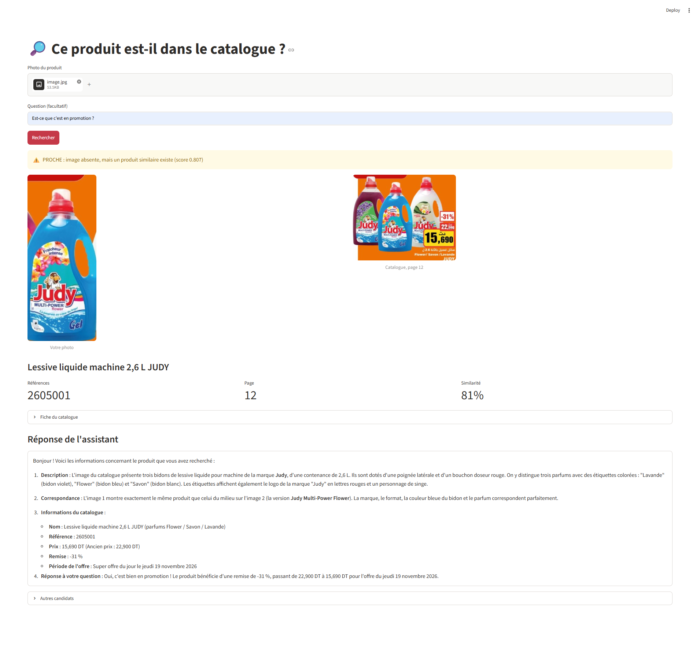

# Visual RAG with SigLIP2, LangChain, ChromaDB and Gemini

Visual multimodal RAG application able to retrieve a product from a PDF catalogue using an image or a text query.

The project uses SigLIP2 for multimodal embeddings, ChromaDB as a vector database, Gemini for response generation and Streamlit for the user interface.

## Architecture

```text
PDF Catalogue
     ↓
Image extraction
     ↓
SigLIP2 Embeddings
     ↓
ChromaDB
     ↓
Image / Text Query
     ↓
Similarity Search
     ↓
Retrieved Product
     ↓
Gemini
     ↓
Final Response
```

## Features

- Product search from an image
- Product search from a text description
- SigLIP2 multimodal embeddings
- Vector similarity search with ChromaDB
- Product metadata retrieval
- Gemini generated responses
- Streamlit web interface

## Application



## Run locally

Index the catalogue:

```bash
uv run indexer.py
```

Run a text search:

```bash
uv run rag.py --texte "une bouteille d'huile d'olive"
```

Run an image search:

```bash
uv run rag.py image.jpg
```

Run the complete RAG pipeline with Gemini:

```bash
uv run rag.py image.jpg --gemini
```

Ask a question about the retrieved product:

```bash
uv run rag.py image.jpg "Est-ce que c'est en promotion ?"
```

Run the Streamlit application:

```bash
uv run streamlit run app.py
```

## Technologies

Python, SigLIP2, Hugging Face Transformers, LangChain, ChromaDB, Gemini, PyMuPDF, PyTorch and Streamlit.

## Retrieval Results

The catalogue indexing generated 278 image entries in ChromaDB.

For the test product image, the system retrieved the JUDY liquid detergent with a similarity score of approximately 0.807 and classified it as a visually similar product.